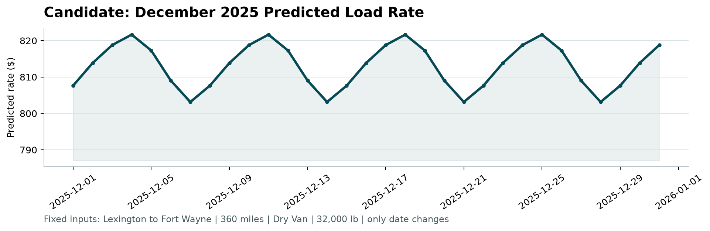

# Freight Rate Prediction – Validation Report

Prepared by Suyog Mansingh · Spotter Machine Learning Engineer assessment · Python 3.12, pandas, scikit-learn

## 1. Summary

The model predicts the posted rate of a truckload from its distance, equipment, weight, origin and destination coordinates and day of week. It is a gradient boosted tree ensemble (scikit-learn `HistGradientBoostingRegressor`) fitted to log(rate), trained on 47,323 clean loads from January to October 2025. On rolling-origin validation, where the model always predicts the two months after its training window, it reaches a mean absolute error of about $50 per load (2.1% MAPE) on clean labels, against $83 (3.7%) for a strong rate-per-mile baseline. The final model deliberately carries no time-level or market-index term, because every variant that did forecast worse out of sample.

## 2. Data and quality issues

Training data: 48,000 loads, 1 January to 31 October 2025, 64 cities, three equipment types. Validation data: 12,000 loads, 1 November to 31 December 2025, with the same columns except the target.

| Issue | Evidence | Treatment |
|---|---|---|
| Corrupted rates | 373 rows with rate per mile above $6 or below $0.50, where the healthy range is $1.67 to $3.18. Bad rows sit at 3 to 5 times, or about one fifth of, the typical rate for the same equipment and distance. | A training row is dropped when its rate is more than double or less than half the median for its equipment and distance bucket. 677 rows (1.4%) removed. |
| Negative weights | 292 training rows and 145 validation rows, for example -36,485 lb. | Treated as sign flips; absolute value taken. |
| Missing values | weight (300 train, 165 validation) and market_index (374, 249). | Trees handle missing weight natively. Missing market_index is filled with the day's median. |
| Floored distances | 111 rows where distance is far above the straight-line distance. All are short hauls floored at 70 miles. Rates follow the recorded distance. | Left unchanged. |
| Unseen cities | 8 validation cities (Chicago, Charlotte, San Diego, Norfolk, Knoxville, Allentown, Jackson, Laredo) never occur in training, affecting 1,447 validation rows (12%). | Geography is learned from coordinates, never from city names, so new cities are handled like any other point on the map. |

Key structural findings: coordinates are fixed per city, so a lookup rebuilds them for the December inputs. `market_index` is a daily market signal (within-day spread is one seventh of the yearly spread) that tracks the daily median rate per mile with correlation 0.64. `quote_signal` is mostly per-load noise. Rate per mile falls steeply with distance ($2.87 under 150 miles, $1.91 over 2,000), Reefer costs about 13% more per mile than Dry Van and Flatbed about 8% more, heavier loads pay slightly more, and Wednesday and Thursday run about 2% above the weekend.

## 3. Train/test split and validation approach

The validation set lies entirely after the training data in time, so the task is a two-month forecast. A random split would let the model see the same market conditions it is tested on and would overstate accuracy. All experiments therefore use forward-in-time splits.

**Experiment 1, single split.** Train January to August, test September and October. Used to choose features and target. Results on clean test labels: log(rate) beats raw rate and rate-per-mile targets; dropping corrupted rows improves MAE from $99 to $88; coordinates plus equipment, weight and distance explain almost everything.

**Experiment 2, the market index.** The same split showed the model with market signals (MAE $88) losing to the model without them ($44). Decomposing the daily rate level showed it is explained jointly by the market index (+11.5% per index point) and a slow upward drift (+1.9% per 100 days), R² 0.76. In September the index fell back to January levels while rates stayed high, so an index-driven model forecast too low. Four strategies for projecting the level were compared: trend extrapolated, trend frozen, index only, and recent eight-week average.

**Experiment 3, rolling-origin validation.** To avoid choosing on one lucky fold, the comparison was repeated for three cutoffs, each predicting the following two months.

| Level strategy | Jul–Aug | Aug–Sep | Sep–Oct | Mean MAE | Mean bias |
|---|---|---|---|---|---|
| None (final model) | $54.7 | $53.4 | $42.8 | **$50.3** | -0.3% |
| Recent 8-week average | $88.7 | $79.3 | $43.3 | $70.4 | +1.8% |
| Index + trend, trend frozen | $130.6 | $59.8 | $50.6 | $80.3 | +1.6% |
| Index + trend, extrapolated | $176.3 | $60.9 | $49.1 | $95.4 | +2.7% |
| Index centred on training mean | $48.2 | $83.4 | $81.7 | $71.1 | -2.3% |

The level-free model wins every fold. The fitted index coefficient swung from negative to strongly positive as the training window grew, which shows the relationship is not stable enough to extrapolate two months ahead. The chosen model carries the average level of the whole training period, which proved the most reliable anchor.

## 4. Final model

Two-stage design implemented in `model.py`. Stage one is the gradient boosted shape model on 15 features: distance, log distance, weight, four coordinates, latitude and longitude deltas, straight-line distance, circuity, day of week, equipment, and each load's deviation of market_index and quote_signal from the daily median. Stage two, the daily level, is fitted and reported but set to zero in the submitted model following the evidence above. Hyper-parameters: 800 trees, learning rate 0.04, 31 leaves, minimum 40 samples per leaf, L2 regularisation 1.0.

Sanity checks on the 12,000 validation predictions: median predicted rate per mile $2.145 against $2.145 in clean training data; per-equipment medians within 1%; loads touching unseen cities predicted at $2.141 per mile against $2.145 for the rest.

## 5. December chart

The fixed lane, Lexington to Fort Wayne, 360 miles, Dry Van, 32,000 lb, has 21 clean Dry Van loads in training at $758 to $934, averaging $820 in September and October. The model predicts $803 to $822 across December, mean $813. With no time-level term, the only date-driven input is day of week, so the curve shows the weekly cycle learned from the data: highest on Thursday, lowest on Sunday. The daily market index for December sits in a narrow band (0.83 to 1.05) and the validated model does not use it, so no additional December movement is predicted.

## 6. Reproduction

`uv sync`, then `uv run python train.py`. That fits the model on all clean data, saves it to `models/freight_rate_model.joblib`, writes `validation_predictions.csv`, and fills the `predicted_rate` column of `data/december_chart_inputs.csv` in place. The provided `score.py` then validates both files and draws the chart above, using the exact command given in the brief. `predict.py` scores any CSV from the saved artifact without retraining, and `pytest` covers the cleaning rules, feature pipeline and output formats. Validation experiments: `validate.py`, `validate_level.py`, `validate_folds.py`. All cleaning and feature code lives in `features.py`, so training and inference cannot diverge. Full run instructions, including a pip-only path and a Makefile, are in the repository README.
